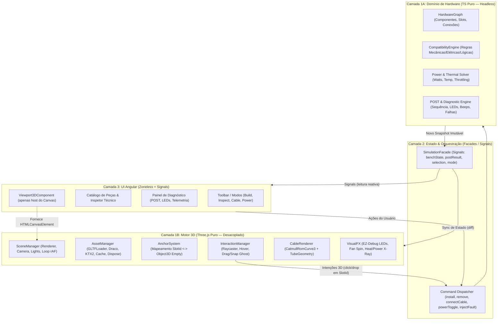

# 02 — Arquitetura Angular + Three.js e Estrutura de Pastas

---

## 1. Análise de Engenharia da Arquitetura

* **FATO TÉCNICO:** Integrar Three.js diretamente dentro de componentes Angular usando detecção de mudanças padrão (`Zone.js`) causa queda drástica de FPS, vazamento de memória WebGL e código altamente acoplado onde regras de negócio (compatibilidade de hardware) se misturam com `THREE.Mesh`.
* **DECISÃO DE PROJETO:** Adotar uma **Arquitetura em 3 Camadas Estritamente Desacopladas** com Angular moderno (**Standalone Components + Signals + Zoneless** `provideExperimentalZonelessChangeDetection()` / Zoneless nativo) e **Three.js puro** encapsulado em um motor dedicado.

---

## 2. Diagrama de Arquitetura (Fluxo Unidirecional)



### 2.1 Responsabilidades por Camada

1. **`domain/` (TypeScript Puro — Zero imports de `@angular/*` ou `three`):**
   - Mantém o grafo de montagem (`BenchState`), executa validação de compatibilidade, calcula consumo elétrico e temperatura, e roda a máquina de estados do POST.
   - **Vantagem de Engenharia:** 100% testável com testes unitários rápidos em Node/Vitest, determinístico e serializável em JSON (permite salvar/carregar builds e cenários de diagnóstico).
2. **`state/` (Angular Services + Signals):**
   - `SimulationFacade`: expõe `computed()` signals para a UI (ex.: `totalWatts()`, `activeWarnings()`, `postStage()`, `selectedComponent()`) e despacha comandos para o `domain/`.
   - Mantém histórico de comandos (base pronta para `Undo/Redo`).
3. **`engine/` (Three.js Puro — Zero imports de `@angular/*`):**
   - Recebe um `HTMLCanvasElement` no `init()` e um callback de eventos de interação (ex.: `onSlotClicked`, `onPartHovered`, `onPartDropped`).
   - Reage a mudanças de estado do `BenchState` via um `SceneSynchronizer` que instancia/remove meshes, atualiza rotação de fans, acende LEDs EZ-Debug e gera curvas de cabos.
   - Roda seu próprio `requestAnimationFrame` com `deltaTime` limitado (clamp de `0.05s` para evitar saltos ao trocar de aba) e suporta renderização sob demanda ou contínua conforme animações ativas.
4. **`features/` (UI Angular Standalone):**
   - Componentes enxutos, puramente apresentacionais ou conectados apenas às Facades. `Viewport3DComponent` só cria o `<canvas>`, observa `ResizeObserver` e chama `engine.resize()` / `engine.dispose()` no `DestroyRef`.

---

## 3. Regras Críticas de Performance e Memória WebGL

* **FATO TÉCNICO:** Recriar geometrias ou materiais a cada frame ou esquecer `dispose()` ao trocar peças provoca vazamento irreversível de VRAM.
* **SUGESTÃO DE ENGENHARIA:**
  - **Object Pooling / Cache de Templates GLB:** O `AssetManager` carrega cada modelo GLB uma única vez como *template* e faz `clone()` leve de cena/transformação compartilhando `BufferGeometry` e `Material` imutáveis; materiais que mudam de cor (emissivo de LED, highlight de hover, heatmap) são clonados controladamente e descartados no `remove()`.
  - **Pixel Ratio Limitado:** `renderer.setPixelRatio(Math.min(window.devicePixelRatio, 2))` para evitar sobrecarga em telas 4K/Retina.
  - **Raycasting Seletivo:** Nunca rodar `raycaster.intersectObjects(scene.children, true)` na cena inteira. Usar listas dedicadas de *hitboxes/colliders* (apenas slots ativos ou peças interativas conforme o modo atual).

---

## 4. Estrutura de Pastas Proposta

```text
projeto_techbench_3d/
├── ENGINEERING_RULES.md
├── docs/
│   └── sprint-0/
│       ├── README.md
│       ├── 01-visao-geral-e-escopo.md
│       ├── 02-arquitetura-e-estrutura.md
│       ├── 03-modelo-de-dados-e-estados.md
│       ├── 04-compatibilidade-conexoes-diagnostico.md
│       ├── 05-interacao-3d-e-ux.md
│       └── 06-padroes-3d-nomenclatura-e-assets.md
├── public/
│   └── assets/
│       ├── models/                 # GLBs otimizados (Draco/KTX2) por categoria
│       │   ├── bench/
│       │   ├── motherboards/
│       │   ├── cpus/
│       │   ├── coolers/
│       │   ├── ram/
│       │   ├── gpus/
│       │   ├── storage/
│       │   └── psus/
│       ├── audio/                  # Beeps de POST, cliques de encaixe, fan loop
│       ├── hdri/                   # Environment maps leves (.hdr/.ktx2)
│       └── manifests/
│           └── assets.manifest.json
└── src/
    ├── main.ts
    └── app/
        ├── app.component.ts
        ├── app.config.ts           # Zoneless + providers
        ├── domain/                 # TS PURO (Zero Angular / Zero Three.js)
        │   ├── models/             # Tipos: ComponentSpec, InstalledComponent, Slot, Cable, BenchState
        │   ├── catalog/            # Dados de peças reais/didáticas (JSON/TS tipado)
        │   ├── compatibility/      # Regras: SocketRule, RamRule, PowerRule, OrderRule
        │   ├── connections/        # Grafo elétrico, barramentos de dados, validação de cabos
        │   ├── simulation/         # PowerSolver, ThermalSolver, PostEngine, FaultInjector
        │   └── scenarios/          # Cenários pré-montados de diagnóstico/troubleshooting
        ├── engine/                 # THREE.JS PURO (Zero Angular)
        │   ├── core/               # SceneManager, CameraRig, LightingRig, RenderLoop
        │   ├── assets/             # AssetManager, GreyboxFactory, DisposalTracker
        │   ├── sync/               # SceneSynchronizer (BenchState -> Cena 3D)
        │   ├── anchors/            # AnchorRegistry (SlotId/PortId <-> THREE.Object3D)
        │   ├── interaction/        # InteractionController, RaycastService, GhostPreview
        │   ├── cables/             # CableMeshBuilder (CatmullRom + TubeGeometry)
        │   └── fx/                 # DebugLedController, FanAnimator, XRayOverlay
        ├── state/                  # FACADES ANGULAR (Signals)
        │   ├── simulation.facade.ts
        │   ├── interaction.facade.ts
        │   └── catalog.facade.ts
        ├── features/               # UI ANGULAR (Standalone Components)
        │   ├── workbench/          # Layout principal + Viewport3DComponent
        │   ├── catalog-drawer/     # Seleção de peças e filtros
        │   ├── inspector-panel/    # Detalhes técnicos, pinagem e estado da peça selecionada
        │   ├── diagnostics-panel/  # Controle de Power, POST log, LEDs, telemetria, desafios
        │   └── mode-toolbar/       # Alternância: Build / Cable / Inspect / Diagnose
        └── shared/                 # Utilitários puros, pipes, componentes UI genéricos
            ├── ui/
            └── utils/
```

* **SUGESTÃO DE ENGENHARIA:** Configurar regras de lint (ESLint `no-restricted-imports` ou boundaries) desde a Sprint 1 para **proibir fisicamente** que `src/app/domain/**` importe `three` ou `@angular/*`, e que `src/app/engine/**` importe `@angular/*`. Isso garante que a arquitetura sobreviva à evolução do projeto.
