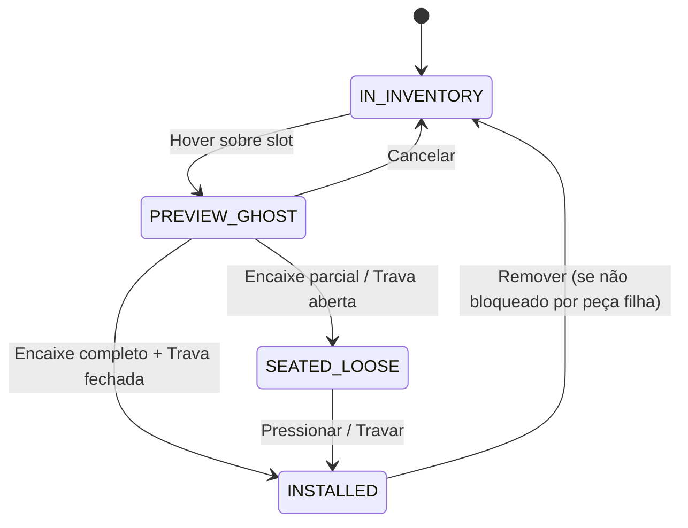

# 03 — Modelo de Dados e Estados dos Componentes

---

## 1. Princípio de Separação: Especificação vs. Instância

* **FATO TÉCNICO:** Um erro comum em simuladores é misturar as especificações estáticas de um produto (ex.: "Intel Core i5-13600K tem socket LGA1700 e TDP 125W") com o estado mutável de uma peça instalada na bancada (ex.: "está a 78 °C, sem pasta térmica, com 1 pino torto simulado").
* **DECISÃO DE PROJETO:** Separar estritamente **`ComponentSpec`** (imutável, vindo do catálogo) de **`ComponentInstance`** (mutável, vivendo dentro do `BenchState`).

---

## 2. Modelo de Dados Principal (Contratos TypeScript)

### 2.1 Categorias, Slots e Portas

```ts
export type ComponentCategory =
  | 'BENCH'
  | 'MOTHERBOARD'
  | 'CPU'
  | 'CPU_COOLER'
  | 'RAM'
  | 'GPU'
  | 'STORAGE_M2'
  | 'PSU';

export type SlotType =
  | 'BENCH_MB_MOUNT'
  | 'BENCH_PSU_MOUNT'
  | 'CPU_SOCKET'
  | 'CPU_COOLER_MOUNT'
  | 'DIMM_SLOT'
  | 'PCIE_X16_SLOT'
  | 'M2_SLOT';

export type PowerPortType =
  | 'ATX_24PIN'
  | 'EPS_8PIN'       // 4+4 CPU Power
  | 'PCIE_8PIN'      // 6+2 GPU Power
  | 'PCIE_12VHPWR'   // 12+4 GPU Power
  | 'FAN_4PIN_PWM';  // CPU_FAN / SYS_FAN

export interface SlotDefinition {
  id: string;                  // Ex: "SLOT_DIMM_A2"
  type: SlotType;
  anchorName: string;          // Nome exato do Empty no GLB (ex: "ANCHOR_SLOT_DIMM_A2")
  label: string;               // Ex: "DIMM A2 (Canal A - Prioritário)"
  channel?: 'A' | 'B';         // Para RAM dual-channel
  priority?: number;           // Ordem recomendada de população (1 = A2/B2, 2 = A1/B1)
  pcieLanes?: 16 | 8 | 4 | 1;  // Lanes elétricas reais do slot
  supportedFormats?: string[]; // Ex: ["LGA1700"], ["DDR5"], ["M2_2280_NVME"]
  requiresParentInstalled?: SlotType[]; // Ex: Cooler exige CPU instalada (ou alerta)
}

export interface PortDefinition {
  id: string;                  // Ex: "PORT_MB_EPS_8PIN_01"
  type: PowerPortType;
  direction: 'SOURCE' | 'SINK';
  anchorName: string;          // Ex: "ANCHOR_PORT_EPS_8PIN_01"
  maxWatts: number;            // Ex: 150W por PCIe 8-pin, 300W por EPS 8-pin, 600W 12VHPWR
  requiredForBoot: boolean;
}
```

### 2.2 Especificações de Catálogo (`ComponentSpec`)

```ts
export interface BaseComponentSpec {
  id: string;                  // Ex: "cpu_intel_i5_13600k"
  category: ComponentCategory;
  name: string;
  brand: string;
  assetId: string;             // Referência ao assets.manifest.json
  dimensionsMm: { x: number; y: number; z: number };
  tdpWatts: number;            // Consumo nominal sob carga
  idleWatts: number;           // Consumo em idle/POST
  descriptionDidactic: string; // Explicação de arquitetura para o modo Inspect
}

export interface MotherboardSpec extends BaseComponentSpec {
  category: 'MOTHERBOARD';
  socket: 'LGA1700' | 'AM5';
  chipset: string;             // Ex: "Z790", "B650"
  ramGeneration: 'DDR4' | 'DDR5';
  maxRamSpeedMt: number;
  slots: SlotDefinition[];
  ports: PortDefinition[];
  hasDebugLeds: boolean;
  hasSpeaker: boolean;
}

export interface CpuSpec extends BaseComponentSpec {
  category: 'CPU';
  socket: 'LGA1700' | 'AM5';
  supportedRam: ('DDR4' | 'DDR5')[];
  hasIntegratedGraphics: boolean;
  tjMaxCelsius: number;        // Ex: 100
  throttleTempCelsius: number; // Ex: 95
}

export interface CoolerSpec extends BaseComponentSpec {
  category: 'CPU_COOLER';
  supportedSockets: ('LGA1700' | 'AM5')[];
  maxTdpCoolingWatts: number;  // Capacidade de dissipação
  ports: PortDefinition[];     // Ex: FAN_4PIN_PWM
}

export interface RamSpec extends BaseComponentSpec {
  category: 'RAM';
  generation: 'DDR4' | 'DDR5';
  capacityGb: number;
  speedMt: number;
  voltage: number;             // 1.2V/1.35V DDR4 | 1.1V DDR5
}

export interface GpuSpec extends BaseComponentSpec {
  category: 'GPU';
  interface: 'PCIE_X16';
  pcieGeneration: 4 | 5;
  ports: PortDefinition[];     // Conectores auxiliares exigidos
  tjMaxCelsius: number;
}

export interface StorageM2Spec extends BaseComponentSpec {
  category: 'STORAGE_M2';
  formFactor: 'M2_2280';
  protocol: 'NVME' | 'SATA';
  capacityGb: number;
}

export interface PsuSpec extends BaseComponentSpec {
  category: 'PSU';
  wattage: number;             // Ex: 550, 750, 850
  efficiencyRating: '80+ Bronze' | '80+ Gold';
  ports: PortDefinition[];     // Fontes disponíveis de cabos
}
```

### 2.3 Instância na Bancada (`ComponentInstance`) e Estado Global (`BenchState`)

```ts
export interface ComponentInstance {
  instanceId: string;          // UUID da instância na bancada
  specId: string;              // FK para ComponentSpec
  parentInstanceId: string | null;
  mountedSlotId: string | null;

  // Estados dinâmicos (detalhados na Seção 3)
  mountState: MountState;
  powerState: PowerState;
  thermalState: ThermalState;
  healthState: HealthState;

  // Propriedades específicas de instância
  hasThermalPaste?: boolean;   // Aplicável a CPU / Cooler
  latchLocked?: boolean;       // Trava de socket CPU / trava DIMM / trava PCIe
  injectedFaults: InjectedFault[];
}

export interface CableConnection {
  connectionId: string;
  cableType: PowerPortType;
  fromInstanceId: string;
  fromPortId: string;
  toInstanceId: string;
  toPortId: string;
  seatingState: 'FIRM' | 'LOOSE'; // Permite simular cabo mal encaixado!
  waypointIds?: string[];         // Para roteamento visual 3D
}

export interface BenchState {
  scenarioId: string | null;
  powerSwitchOn: boolean;      // Chave traseira da PSU (I/O)
  systemPowerOn: boolean;      // Botão Power da bancada
  components: Record<string, ComponentInstance>;
  cables: Record<string, CableConnection>;
  postResult: PostDiagnosticResult | null;
}
```

---

## 3. Estados dos Componentes (Máquinas de Estado)

Cada componente na bancada possui **4 dimensões ortogonais de estado** (em vez de um único `enum` confuso):

### 3.1 Estado Físico / Montagem (`MountState`)

* **SUGESTÃO DE ENGENHARIA:** O estado `SEATED_LOOSE` é ouro para o modo Diagnóstico — simula um dos defeitos reais mais comuns em bancadas (pente de RAM ou GPU parcialmente encaixado que causa falha no POST).

### 3.2 Estado Elétrico (`PowerState`)
- `UNPOWERED`: Sem conexão elétrica ou PSU desligada na chave traseira.
- `STANDBY_5VSB`: PSU ligada na chave (`I`), cabo ATX 24-pin conectado, placa-mãe em standby (LED de standby aceso).
- `POWERED_ON`: Recebendo alimentação nominal em todos os rails necessários.
- `UNDERPOWERED`: Alimentação parcial (ex.: GPU encaixada no slot PCIe de 75W, mas sem cabo auxiliar 8-pin).
- `PROTECTION_TRIPPED`: Fonte desarmou (OPP/OCP por sobrecarga ou curto simulado).

### 3.3 Estado Térmico (`ThermalState`)
```ts
export interface ThermalState {
  currentTempC: number;
  targetTempC: number;
  status: 'AMBIENT' | 'NORMAL' | 'WARM' | 'THROTTLING' | 'CRITICAL_SHUTDOWN';
  fanRpm: number; // 0 quando desligado ou sem conexão FAN_4PIN_PWM
}
```

### 3.4 Estado de Saúde / Falhas Injetáveis (`HealthState` & `InjectedFault`)
- `HEALTHY`: Componente funcional.
- `DEGRADED`: Funciona com limitação (ex.: cooler sem pasta térmica ou RAM em single-channel).
- `FAULTY`: Componente com defeito físico/eletrônico injetado por cenário de diagnóstico.

Tipos de `InjectedFault` suportados na v1:
- `'DEAD_COMPONENT'` (ex.: módulo RAM queimado ou PSU morta)
- `'LOOSE_SEATING'` (peça ou cabo frouxo)
- `'MISSING_THERMAL_PASTE'` (CPU sem pasta térmica)
- `'FAN_STALLED'` (ventoinha do cooler travada/desconectada)
- `'BIOS_INCOMPATIBLE'` (CPU compatível com socket, mas exigindo atenção de firmware — *aviso didático*)
