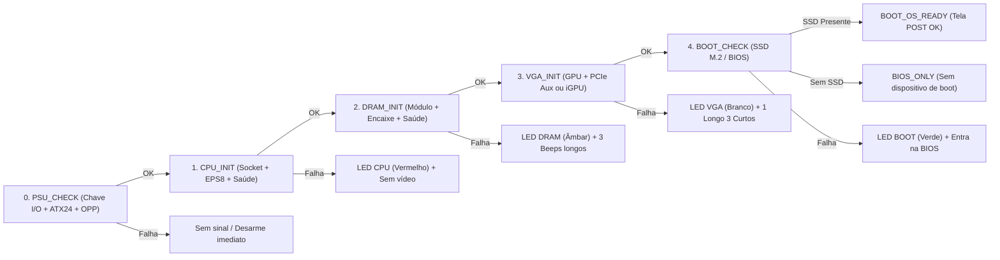

# 04 — Sistema de Compatibilidade, Conexões e Diagnóstico (POST)

---

## 1. Sistema de Compatibilidade (Motor de Regras em Camadas)

* **FATO TÉCNICO:** Nem toda incompatibilidade de hardware impede a montagem física. Algumas impedem o encaixe (chanfro DDR4 vs DDR5), outras permitem encaixar mas impedem o boot (CPU sem cooler/cabo EPS ausente), e outras apenas degradam performance (RAM em slots A1+A2 sem dual-channel).
* **DECISÃO DE PROJETO:** O `CompatibilityEngine` avalia cada ação e o estado global retornando uma lista de `ValidationIssue` com 3 níveis de severidade:
  - `BLOCKER_PHYSICAL`: Impede o encaixe 3D (ex.: CPU AM5 em socket LGA1700, RAM DDR4 em slot DDR5, GPU em slot M.2).
  - `ERROR_BOOT`: Permite montar, mas falha ao ligar/POST (ex.: cabo EPS 8-pin ausente, GPU sem cabo PCIe auxiliar, potência exigida > capacidade da PSU, RAM `SEATED_LOOSE`).
  - `WARNING_OPTIMIZATION`: Liga e dá boot, mas gera alerta técnico/didático (ex.: RAM fora dos slots A2/B2 sem dual-channel, CPU sem pasta térmica causando throttling, GPU instalada em slot PCIe secundário x4, cooler com TDP abaixo do TDP da CPU).

### 1.1 Matriz de Regras da v1

| Camada | Regra | Condição | Severidade | Explicação Didática |
| --- | --- | --- | --- | --- |
| **Mecânica** | `RULE_SOCKET_MATCH` | `cpu.socket !== mb.socket` | `BLOCKER_PHYSICAL` | Pinagem e formato físico incompatíveis (ex.: LGA1700 vs AM5). |
| **Mecânica** | `RULE_RAM_GEN_MATCH` | `ram.generation !== mb.ramGeneration` | `BLOCKER_PHYSICAL` | Chanfro físico (key notch) e especificação elétrica incompatíveis. |
| **Mecânica** | `RULE_COOLER_SOCKET` | `!cooler.supportedSockets.includes(mb.socket)` | `BLOCKER_PHYSICAL` | Furação do bracket do cooler incompatível com o socket. |
| **Ordem** | `RULE_CPU_BEFORE_COOLER` | Instalar cooler sem CPU no socket | `BLOCKER_PHYSICAL` | O cooler deve ser montado sobre a CPU instalada e travada. |
| **Ordem** | `RULE_REMOVE_BLOCKED` | Remover CPU com cooler instalado | `BLOCKER_PHYSICAL` | Remova o cooler antes de destravar e retirar a CPU. |
| **Elétrica** | `RULE_ATX24_REQUIRED` | Falta cabo `ATX_24PIN` na MB | `ERROR_BOOT` | Placa-mãe sem alimentação principal e sinal `PS_ON# / PWR_OK`. |
| **Elétrica** | `RULE_EPS8_REQUIRED` | Falta cabo `EPS_8PIN` na MB | `ERROR_BOOT` | VRM da CPU sem alimentação 12V dedicada; sistema não passa do estágio CPU no POST. |
| **Elétrica** | `RULE_GPU_AUX_POWER` | GPU requer `PCIE_8PIN`/`12VHPWR` desconectado | `ERROR_BOOT` | Slot PCIe fornece no máximo 75W; GPU não inicializa sem energia auxiliar. |
| **Elétrica** | `RULE_PSU_WATTAGE` | `peakDemandWatts > psu.wattage` | `ERROR_BOOT` | Fonte subdimensionada: proteção OPP desarma o sistema ao ligar/sob carga. |
| **Elétrica** | `RULE_CABLE_KEYING` | Tentar conectar `PCIE_8PIN` em `EPS_8PIN` | `BLOCKER_PHYSICAL` | Polaridade de 12V/GND invertida e pinos chaveados fisicamente diferentes. |
| **Lógica** | `RULE_RAM_DUAL_CHANNEL` | 2 pentes instalados fora de `A2 + B2` | `WARNING_OPTIMIZATION` | Memórias operando em Single-Channel ou fora dos slots primários (menor largura de banda / estabilidade). |
| **Lógica** | `RULE_VIDEO_OUTPUT` | Sem GPU dedicada E CPU sem iGPU | `ERROR_BOOT` | Sem controlador gráfico disponível; falha no estágio `VGA` do POST. |
| **Térmica** | `RULE_COOLER_MISSING` | Ligar sem cooler instalado | `ERROR_BOOT` (ou shutdown rápido) | CPU atinge `TjMax` em segundos e aciona proteção térmica de desligamento. |
| **Térmica** | `RULE_PASTE_MISSING` | Cooler instalado sem pasta térmica | `WARNING_OPTIMIZATION` | Alta resistência térmica entre IHS e dissipador; gera throttling severo. |

---

## 2. Sistema de Conexões (Energia e Dados)

O sistema modela dois grafos complementares sobre os mesmos componentes:

### 2.1 Grafo de Energia (Explícito — Cabos Conectados pelo Usuário)
- **Origem (`SOURCE`):** Portas da `PSU` (`ATX_24PIN`, `EPS_8PIN`, `PCIE_8PIN`, `PCIE_12VHPWR`) e headers da `Motherboard` (`FAN_4PIN_PWM`).
- **Destino (`SINK`):** Portas da `Motherboard`, `GPU` e `CPU_COOLER`.
- **Cálculo de Demanda (`PowerSolver`):**
  $$P_{\text{total}} = P_{\text{MB}} + P_{\text{CPU}} + P_{\text{GPU}} + \sum P_{\text{RAM}} + \sum P_{\text{M2}} + P_{\text{Cooler}}$$
  - Em **POST / Idle**: usa `idleWatts` + margem de inrush (1.15x).
  - Em **Stress Test (Modo Diagnóstico)**: usa `tdpWatts` + transiente de pico (1.25x para GPU) para revelar fontes subdimensionadas que "ligam mas desligam sob carga"!
  - *SUGESTÃO DE ENGENHARIA:* Incluir um botão **"Teste de Carga (Stress Test)"** após o boot bem-sucedido — isso permite ensinar na prática a diferença entre uma fonte que passa no POST mas desarma em carga (OPP) e o superaquecimento por falta de pasta térmica.

### 2.2 Grafo de Dados / Barramentos (Implícito — Derivado dos Slots)
- Quando componentes são encaixados nos slots da placa-mãe, o domínio constrói automaticamente as rotas lógicas para o modo **Arquitetura / Raio-X**:
  - `CPU ↔ DIMM_A1/A2/B1/B2` (Barramento de Memória — exibe `Single-Channel` vs `Dual-Channel`).
  - `CPU ↔ PCIE_X16_1` (Barramento PCIe direto da CPU — 16 lanes).
  - `CPU ↔ M2_1` (4 lanes PCIe diretas da CPU) e `Chipset ↔ M2_2`.

---

## 3. Motor de POST e Diagnóstico (v1)

Ao pressionar o botão **Power** da bancada, o `PostEngine` executa uma máquina de estados determinística em etapas cronometradas (ex.: 400ms–700ms por estágio, para o usuário ver os LEDs acenderem em sequência como numa placa-mãe real):



### 3.1 Contrato de Saída (`PostDiagnosticResult`)

```ts
export type PostStage = 'OFF' | 'PSU_CHECK' | 'CPU_INIT' | 'DRAM_INIT' | 'VGA_INIT' | 'BOOT_CHECK' | 'POST_OK' | 'BIOS_ONLY';

export interface PostDiagnosticResult {
  success: boolean;
  reachedStage: PostStage;
  activeDebugLed: 'NONE' | 'CPU' | 'DRAM' | 'VGA' | 'BOOT';
  beepPattern: ('SHORT' | 'LONG')[];
  screenOutput: 'NO_SIGNAL' | 'BIOS_SETUP' | 'POST_SUCCESS';
  rootCauses: ValidationIssue[]; // Ocultável no "Modo Desafio" até o usuário diagnosticar
  telemetry: {
    estimatedIdleWatts: number;
    estimatedLoadWatts: number;
    cpuTempC: number;
    gpuTempC: number;
    ramChannelMode: 'NONE' | 'SINGLE' | 'DUAL';
  };
}
```
